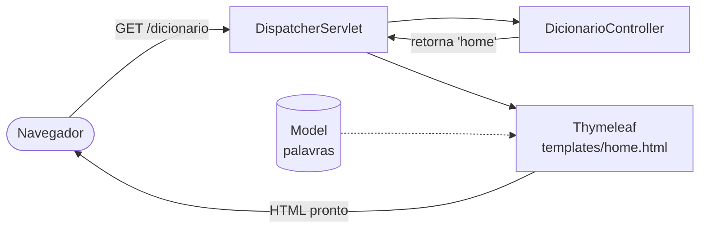
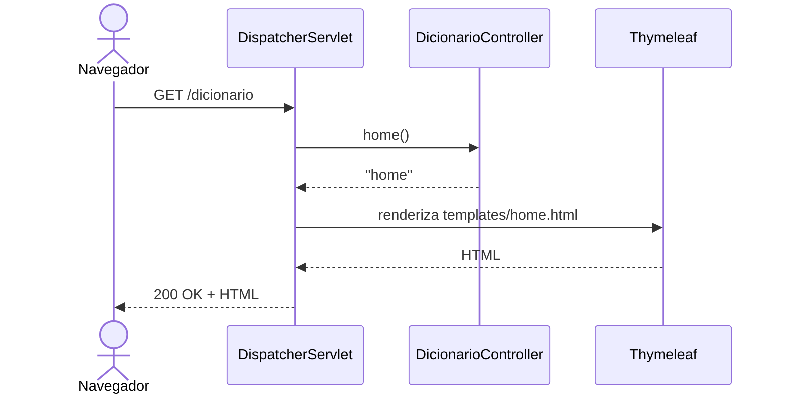
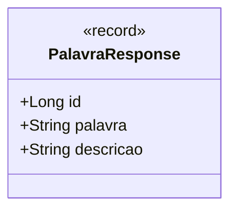
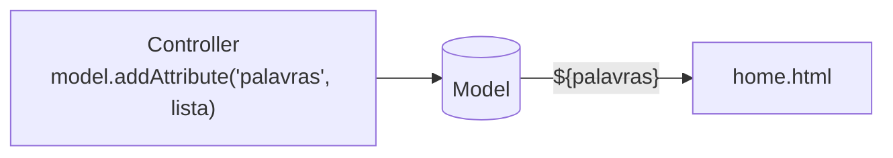
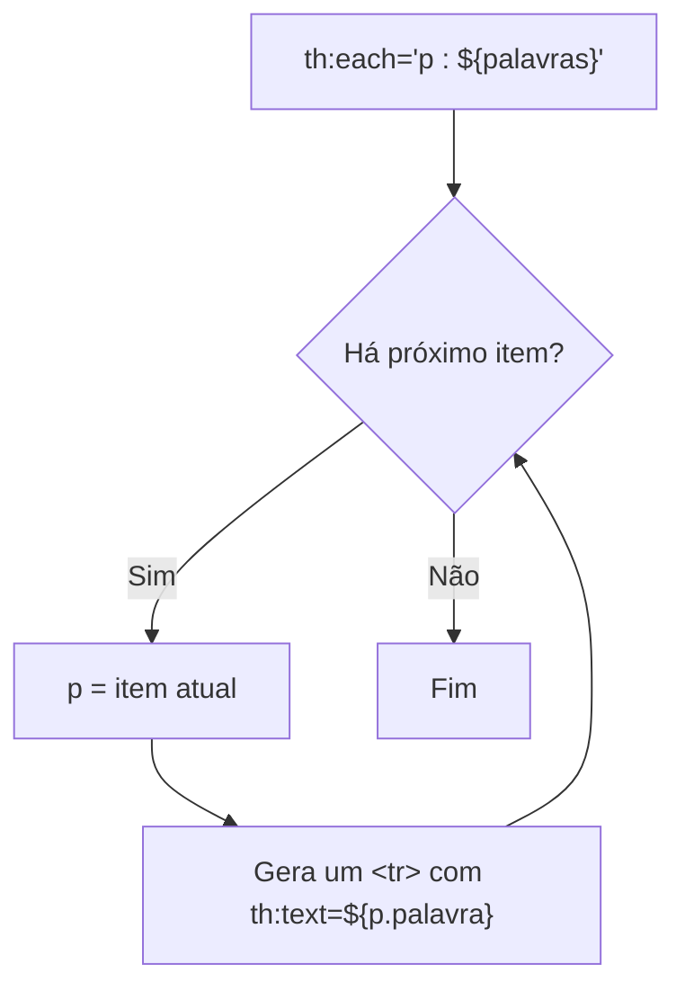
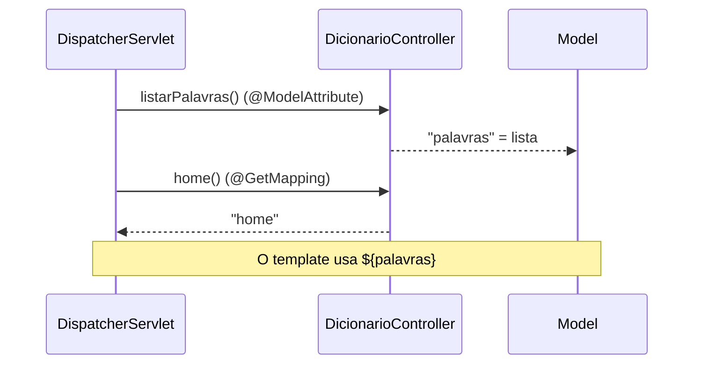
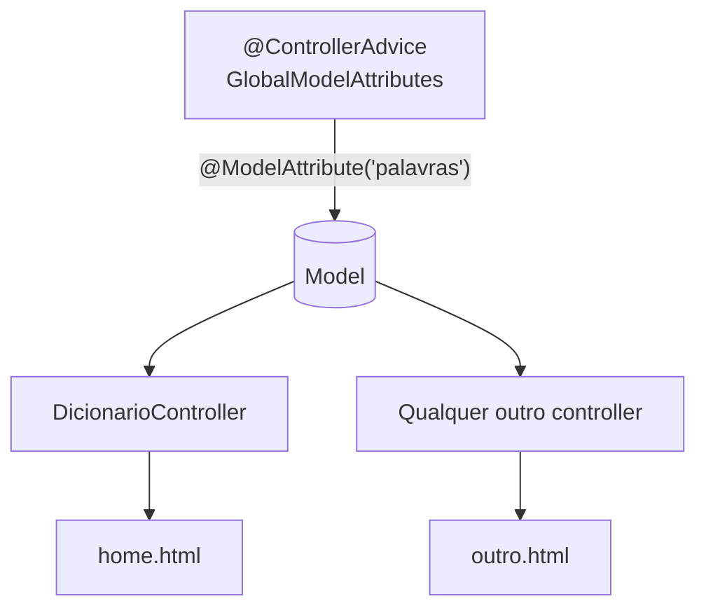
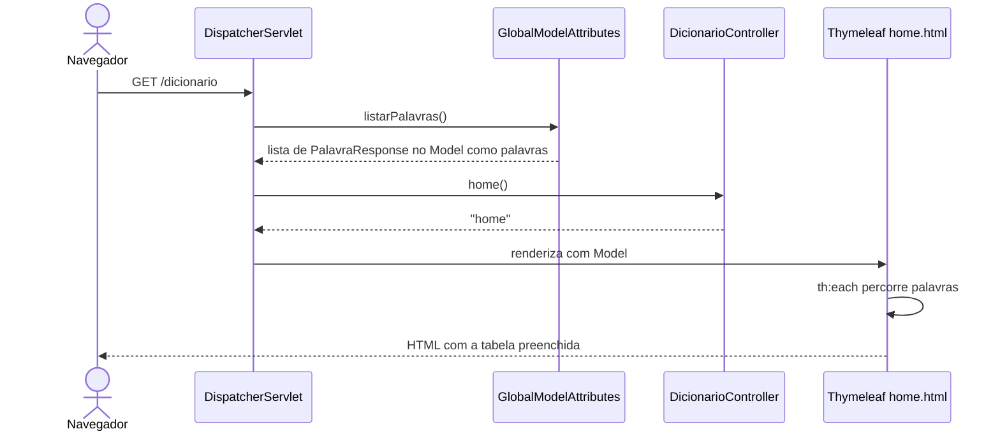
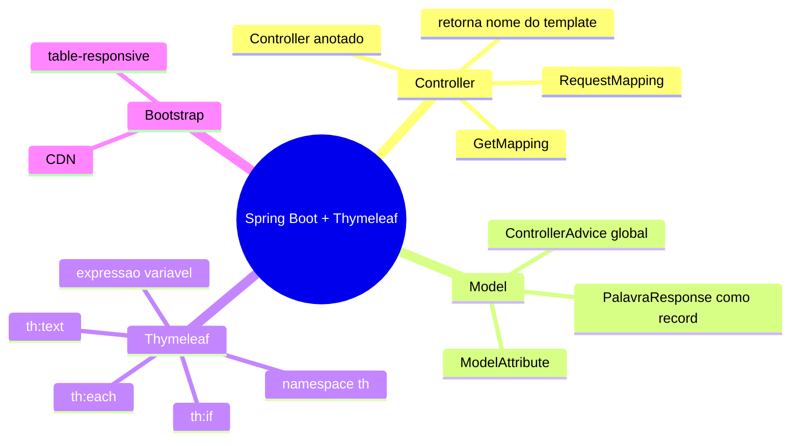

# Dicionário de Cringe

Um dicionário de termos e expressões consideradas "cringe" na cultura pop.

Aula introdutória de **Spring Boot + Thymeleaf** para criação de páginas web renderizadas no servidor. Siga os passos na ordem para reproduzir o projeto.

## Sumário

1. [Visão geral da arquitetura](#1-visão-geral-da-arquitetura)
2. [Criando o projeto](#2-criando-o-projeto)
3. [Dependências](#3-dependências)
4. [Estrutura de pastas](#4-estrutura-de-pastas)
5. [Primeiro controller e primeira página](#5-primeiro-controller-e-primeira-página)
6. [O modelo de dados: `PalavraResponse`](#6-o-modelo-de-dados-palavraresponse)
7. [Passando objetos para o template com `Model`](#7-passando-objetos-para-o-template-com-model)
8. [Atributos `th:` do Thymeleaf](#8-atributos-th-do-thymeleaf)
9. [`@ModelAttribute` no controller](#9-modelattribute-no-controller)
10. [Lista global com `@ControllerAdvice`](#10-lista-global-com-controlleradvice)
11. [Bootstrap e tabela responsiva](#11-bootstrap-e-tabela-responsiva)
12. [Executando e testando](#12-executando-e-testando)
13. [Resumo e erros comuns](#13-resumo-e-erros-comuns)

---

## 1. Visão geral da arquitetura

O Spring Boot segue o padrão **MVC** (Model-View-Controller):

- **Controller**: recebe a requisição HTTP e decide o que fazer.
- **Model**: os dados que serão exibidos (objetos Java).
- **View**: o template HTML (Thymeleaf) que transforma os dados em HTML final.



O `DispatcherServlet` é o "porteiro" do Spring MVC: ele recebe toda requisição, encontra o controller correto e, depois, pede ao Thymeleaf para renderizar o template cujo nome o controller devolveu.

---

## 2. Criando o projeto

1. Acesse [start.spring.io](https://start.spring.io).
2. Preencha:

| Campo        | Valor                  |
|--------------|------------------------|
| Project      | Gradle - Groovy        |
| Language     | Java                   |
| Spring Boot  | 4.0.0                  |
| Group        | `dev.sdras`            |
| Artifact     | `dicionario_cringe`    |
| Name         | `dicionario_cringe`    |
| Packaging    | Jar                    |
| Java         | 17                     |

3. Adicione as dependências (botão **Add Dependencies**): veja a [seção 3](#3-dependências).
4. Clique em **Generate**, extraia o `.zip` e abra a pasta na IDE (IntelliJ IDEA).
5. Aguarde o Gradle sincronizar.

---

## 3. Dependências

No Initializr, selecione:

- **Thymeleaf**: motor de templates.
- **Spring Web**: MVC e servidor embutido.
- **Validation**: validação de dados (usaremos em aulas futuras).
- **Spring Boot DevTools**: reinício automático ao salvar.
- **H2 Database**: banco em memória.
- **MySQL Driver**: driver para o MySQL.

O resultado é o bloco `dependencies` do `build.gradle`:

```groovy
dependencies {
    implementation 'org.springframework.boot:spring-boot-h2console'
    implementation 'org.springframework.boot:spring-boot-starter-thymeleaf'
    implementation 'org.springframework.boot:spring-boot-starter-validation'
    implementation 'org.springframework.boot:spring-boot-starter-webmvc'
    developmentOnly 'org.springframework.boot:spring-boot-devtools'
    runtimeOnly 'com.h2database:h2'
    runtimeOnly 'com.mysql:mysql-connector-j'
    testImplementation 'org.springframework.boot:spring-boot-starter-thymeleaf-test'
    testImplementation 'org.springframework.boot:spring-boot-starter-validation-test'
    testImplementation 'org.springframework.boot:spring-boot-starter-webmvc-test'
    testRuntimeOnly 'org.junit.platform:junit-platform-launcher'
}
```

> **Nota:** nesta aula **não usamos banco de dados**: os dados ficam em memória, dentro do código. H2 e MySQL serão usados em aulas futuras.

Arquivo `src/main/resources/application.yml` (renomeie o `application.properties` gerado):

```yaml
spring:
  application:
    name: dicionario_cringe
```

---

## 4. Estrutura de pastas

```text
dicionario_cringe/
├── build.gradle
└── src/main/
    ├── java/dev/sdras/dicionario_cringe/
    │   ├── DicionarioCringeApplication.java     # classe principal
    │   ├── controllers/
    │   │   ├── DicionarioController.java        # rota /dicionario
    │   │   └── GlobalModelAttributes.java       # dados globais
    │   └── model/
    │       └── PalavraResponse.java             # record com os dados
    └── resources/
        ├── application.yml
        └── templates/
            └── home.html                        # view Thymeleaf
```

Crie as pastas `controllers` e `model` dentro do pacote `dev.sdras.dicionario_cringe` (botão direito no pacote → **New → Package**).

A classe principal já vem pronta:

```java
@SpringBootApplication
public class DicionarioCringeApplication {

    public static void main(String[] args) {
        SpringApplication.run(DicionarioCringeApplication.class, args);
    }
}
```

`@SpringBootApplication` ativa a configuração automática e o *component scan*: o Spring procura classes anotadas (`@Controller`, `@ControllerAdvice`...) **neste pacote e nos subpacotes**. Por isso os controllers precisam ficar dentro de `dev.sdras.dicionario_cringe`.

---

## 5. Primeiro controller e primeira página

### 5.1 O controller

Crie `controllers/DicionarioController.java`:

```java
package dev.sdras.dicionario_cringe.controllers;

import org.springframework.stereotype.Controller;
import org.springframework.web.bind.annotation.GetMapping;
import org.springframework.web.bind.annotation.RequestMapping;

@Controller
@RequestMapping("/dicionario")
public class DicionarioController {

    @GetMapping
    public String home() {
        return "home";
    }
}
```

| Anotação          | Função |
|-------------------|--------|
| `@Controller`     | Registra a classe como controller MVC. O retorno `String` é o **nome de um template**. |
| `@RequestMapping("/dicionario")` | Prefixo de URL para todos os métodos da classe. |
| `@GetMapping`     | Mapeia requisições **GET** (sem caminho extra, vale `/dicionario`). |

O método retorna `"home"`. O Thymeleaf converte isso em `src/main/resources/templates/home.html` (prefixo `templates/` e sufixo `.html` são o padrão do Spring Boot).

### 5.2 O template

Crie `src/main/resources/templates/home.html`:

```html
<!DOCTYPE html>
<html lang="pt-BR" xmlns:th="http://www.thymeleaf.org">
<head>
    <meta charset="UTF-8">
    <title>Dicionário de Cringe</title>
</head>
<body>
    <h1>Bem-vindo ao Dicionário de Cringe</h1>
    <p>Este é um dicionário de termos e expressões consideradas "cringe" na cultura pop.</p>
</body>
</html>
```

O namespace `xmlns:th="http://www.thymeleaf.org"` habilita os atributos `th:*` e o autocompletar da IDE.

### 5.3 Teste

Execute a classe `DicionarioCringeApplication` e abra <http://localhost:8080/dicionario>. A mensagem de boas-vindas deve aparecer.

> Atenção: `/` (raiz) **não** está mapeado e retornará erro 404. A rota é `/dicionario`.



---

## 6. O modelo de dados: `PalavraResponse`

Cada verbete do dicionário tem `id`, `palavra` e `descricao`. Crie `model/PalavraResponse.java`:

```java
package dev.sdras.dicionario_cringe.model;

public record PalavraResponse(Long id, String palavra, String descricao) {
}
```

Um **record** (Java 16+) é uma classe imutável que gera automaticamente construtor, *getters*, `equals`, `hashCode` e `toString`. Os *getters* **não** têm prefixo `get`: são `id()`, `palavra()` e `descricao()`.



> Como o Thymeleaf lê `${p.palavra}` de um record? A expressão (SpEL) aceita acesso a propriedade e também aos métodos de mesmo nome do record, então `p.palavra`, `p.id` e `p.descricao` funcionam.

---

## 7. Passando objetos para o template com `Model`

O **Model** é um "saco de dados" por requisição: o controller coloca objetos nele com um **nome**, e o template acessa pelo mesmo nome.

Primeiro, a forma explícita. Altere o `DicionarioController`:

```java
@GetMapping
public String home(Model model) {
    List<PalavraResponse> palavras = List.of(
            new PalavraResponse(1L, "Cringe", "Algo que causa vergonha alheia."),
            new PalavraResponse(2L, "FOMO", "Fear of Missing Out - medo de perder algo."),
            new PalavraResponse(3L, "Ghosting", "Quando alguém desaparece sem explicação.")
    );
    model.addAttribute("palavras", palavras);
    return "home";
}
```

Imports necessários: `java.util.List`, `org.springframework.ui.Model` e `dev.sdras.dicionario_cringe.model.PalavraResponse`.

- `Model model`: o Spring injeta o objeto automaticamente.
- `addAttribute("palavras", palavras)`: o **nome** `"palavras"` é a chave usada no template como `${palavras}`.



---

## 8. Atributos `th:` do Thymeleaf

Atributos `th:*` são processados **no servidor**. O Thymeleaf os executa, gera o HTML final e remove o atributo `th:` antes de enviar ao navegador.

| Atributo / Sintaxe | O que faz | Exemplo |
|--------------------|-----------|---------|
| `${...}` | **Expressão de variável**: lê um valor do Model. | `${palavras}` |
| `th:text` | Substitui o texto do elemento (com *escape* de HTML, seguro contra XSS). | `<td th:text="${p.palavra}"></td>` |
| `th:each` | Repete o elemento para cada item de uma coleção. | `<tr th:each="p : ${palavras}">` |
| `th:if` | Renderiza o elemento só se a condição for verdadeira. | `<tr th:if="${#lists.isEmpty(palavras)}">` |
| `#lists` | Objeto utilitário com funções para listas. | `${#lists.isEmpty(palavras)}` |

### Como o `th:each` funciona

```html
<tr th:each="p : ${palavras}">
    <td th:text="${p.palavra}"></td>
</tr>
```

Leia como: "para cada `p` em `palavras`, repita este `<tr>`". Em Java seria `for (PalavraResponse p : palavras)`.



### Antes e depois da renderização

Template (no servidor):

```html
<tr th:each="p : ${palavras}">
    <th scope="row" th:text="${p.id}"></th>
    <td th:text="${p.palavra}"></td>
</tr>
```

HTML recebido pelo navegador:

```html
<tr>
    <th scope="row">1</th>
    <td>Cringe</td>
</tr>
<tr>
    <th scope="row">2</th>
    <td>FOMO</td>
</tr>
```

> Dica: abra "Exibir código-fonte" no navegador. Você não verá nenhum `th:`: o navegador só recebe HTML puro.

---

## 9. `@ModelAttribute` no controller

Colocar `model.addAttribute` em cada método repete código. A anotação `@ModelAttribute` em um **método** faz o Spring chamar esse método **antes de cada handler do controller** e adicionar o retorno ao Model automaticamente.

Refatore o `DicionarioController`:

```java
@Controller
@RequestMapping("/dicionario")
public class DicionarioController {

    @GetMapping
    public String home() {
        return "home";
    }

    @ModelAttribute("palavras")
    public List<PalavraResponse> listarPalavras() {
        return List.of(
                new PalavraResponse(1L, "Cringe", "Algo que causa vergonha alheia.")
                // ...demais palavras
        );
    }
}
```

O `home()` não recebe mais `Model`, mas o template continua enxergando `${palavras}`.



**Limitação:** esse `@ModelAttribute` vale **somente para este controller**. Outros controllers não teriam `palavras`.

---

## 10. Lista global com `@ControllerAdvice`

Para disponibilizar a lista em **qualquer template do projeto**, mova o método para uma classe anotada com `@ControllerAdvice`.

Remova `listarPalavras()` do `DicionarioController` (e os imports não usados) e crie `controllers/GlobalModelAttributes.java`:

```java
package dev.sdras.dicionario_cringe.controllers;

import dev.sdras.dicionario_cringe.model.PalavraResponse;
import org.springframework.web.bind.annotation.ControllerAdvice;
import org.springframework.web.bind.annotation.ModelAttribute;

import java.util.List;

@ControllerAdvice
public class GlobalModelAttributes {

    @ModelAttribute("palavras")
    public List<PalavraResponse> listarPalavras() {
        return List.of(
                new PalavraResponse(1L, "Cringe", "Algo que causa vergonha alheia."),
                new PalavraResponse(2L, "FOMO", "Fear of Missing Out - medo de perder algo."),
                new PalavraResponse(3L, "Ghosting", "Quando alguém desaparece sem explicação."),
                new PalavraResponse(4L, "Flex", "Exibir algo de forma ostentosa."),
                new PalavraResponse(5L, "Salty", "Estar irritado ou ressentido."),
                new PalavraResponse(6L, "Stan", "Ser um fã muito dedicado de alguém ou algo."),
                new PalavraResponse(7L, "Tea", "Fofoca ou informação interessante."),
                new PalavraResponse(8L, "Woke", "Estar consciente de questões sociais e políticas."),
                new PalavraResponse(9L, "Yeet", "Expressão de entusiasmo ou para lançar algo com força."),
                new PalavraResponse(10L, "Zonked", "Estar extremamente cansado ou exausto."),
                new PalavraResponse(11L, "Bae", "Termo carinhoso para se referir a alguém especial."),
                new PalavraResponse(12L, "Lit", "Algo muito bom, divertido ou emocionante"),
                new PalavraResponse(13L, "Savage", "Alguém que age de forma ousada ou sem remorso."),
                new PalavraResponse(14L, "Slay", "Arrasar, se destacar ou ter sucesso em algo."),
                new PalavraResponse(15L, "Thirsty", "Estar desesperado por atenção ou aprovação."),
                new PalavraResponse(16L, "Vibe", "A atmosfera ou sentimento de um lugar, situação ou pessoa."),
                new PalavraResponse(17L, "Clout", "Influência ou poder, especialmente nas redes sociais."),
                new PalavraResponse(18L, "Cancel", "Boicotar ou rejeitar alguém devido a ações ou opiniões consideradas inaceitáveis."),
                new PalavraResponse(19L, "Receipts", "Provas ou evidências que confirmam algo, geralmente usado em discussões ou fofocas."),
                new PalavraResponse(20L, "Shook", "Estar surpreso, chocado ou abalado por algo inesperado.")
        );
    }
}
```

O `DicionarioController` final fica enxuto:

```java
@Controller
@RequestMapping("/dicionario")
public class DicionarioController {

    @GetMapping
    public String home() {
        return "home";
    }
}
```



| | `@ModelAttribute` no controller | `@ModelAttribute` em `@ControllerAdvice` |
|---|---|---|
| Alcance | Só aquele controller | **Todos** os controllers |
| Uso típico | Dado específico da tela | Dado comum (menu, listas, usuário logado) |

> **Cuidado:** o método roda em **toda requisição** a um controller. Mais tarde, com banco de dados, evite consultas pesadas aqui (ou use cache).

---

## 11. Bootstrap e tabela responsiva

Usaremos o Bootstrap 5 via **CDN** (sem instalar nada). O CSS vai no `<head>` e o JS no final do `<body>`.

Substitua o `home.html` pela versão final:

```html
<!DOCTYPE html>
<html lang="pt-BR" xmlns="http://www.w3.org/1999/xhtml" xmlns:th="http://www.thymeleaf.org">
<head>
    <meta charset="UTF-8">
    <meta name="viewport" content="width=device-width, initial-scale=1">
    <title>Dicionário de Cringe</title>
    <link href="https://cdn.jsdelivr.net/npm/bootstrap@5.3.3/dist/css/bootstrap.min.css" rel="stylesheet">
</head>
<body>
<main class="container py-4">
    <h1 class="mb-3">Bem-vindo ao Dicionário de Cringe</h1>
    <p class="lead">Este é um dicionário de termos e expressões consideradas "cringe" na cultura pop.</p>

    <div class="table-responsive">
        <table class="table table-striped table-hover align-middle">
            <thead class="table-dark">
            <tr>
                <th scope="col">#</th>
                <th scope="col">Palavra</th>
                <th scope="col">Descrição</th>
            </tr>
            </thead>
            <tbody>
            <tr th:each="p : ${palavras}">
                <th scope="row" th:text="${p.id}"></th>
                <td th:text="${p.palavra}"></td>
                <td th:text="${p.descricao}"></td>
            </tr>
            <tr th:if="${#lists.isEmpty(palavras)}">
                <td colspan="3" class="text-center text-muted">Nenhuma palavra cadastrada.</td>
            </tr>
            </tbody>
        </table>
    </div>
</main>
<script src="https://cdn.jsdelivr.net/npm/bootstrap@5.3.3/dist/js/bootstrap.bundle.min.js"></script>
</body>
</html>
```

### Classes Bootstrap usadas

| Classe | Efeito |
|--------|--------|
| `<meta name="viewport" ...>` | Necessária para o layout responsivo em celulares. |
| `container` | Centraliza e limita a largura do conteúdo. |
| `py-4`, `mb-3` | Espaçamento (padding vertical, margin-bottom). |
| `lead` | Parágrafo de destaque. |
| `table-responsive` | Cria **rolagem horizontal** em telas pequenas. |
| `table` | Estilo base da tabela. |
| `table-striped` | Linhas alternadas (zebra). |
| `table-hover` | Destaca a linha sob o mouse. |
| `align-middle` | Alinha o conteúdo das células verticalmente. |
| `table-dark` | Cabeçalho escuro. |
| `text-center text-muted` | Texto centralizado e acinzentado. |

> **Teste de responsividade:** abra as ferramentas de desenvolvedor (F12), ative o modo dispositivo e reduza a largura. A tabela passa a rolar horizontalmente em vez de quebrar o layout.
>
> O Bootstrap via CDN exige internet. Sem conexão, a página aparece sem estilo.

---

## 12. Executando e testando

Pela IDE: execute `DicionarioCringeApplication`.

Pelo terminal (na raiz do projeto):

```bash
./gradlew bootRun       # Linux/macOS
gradlew.bat bootRun     # Windows
```

Abra <http://localhost:8080/dicionario>. Resultado esperado: título, texto de apresentação e uma tabela zebrada com as 20 palavras.

Para compilar sem executar:

```bash
./gradlew build
```

Ciclo de vida completo de uma requisição na versão final:



---

## 13. Resumo e erros comuns

### Resumo



### Erros comuns

| Sintoma | Causa provável | Solução |
|---------|----------------|---------|
| 404 em `/` | A rota é `/dicionario` | Acesse `/dicionario` |
| 404 em `/dicionario` | Controller fora do pacote base ou sem `@Controller` | Mover para `dev.sdras.dicionario_cringe.*` |
| `TemplateInputException` / "Error resolving template" | Nome retornado diferente do arquivo | `return "home"` ↔ `templates/home.html` |
| Página exibe o texto literal `${p.palavra}` | Usou `${...}` sem `th:text` | Use `th:text="${p.palavra}"` |
| Tabela vazia | Nome do atributo diferente (`"palavras"`) | O nome em `@ModelAttribute` e em `${...}` deve ser idêntico |
| Página sem estilo | Sem internet ou link do CDN errado | Verifique o `<link>` e a conexão |
| `cannot find symbol: class List` | Falta `import java.util.List;` | Adicione o import |
| `th:` não é reconhecido na IDE | Falta `xmlns:th` no `<html>` | Adicione o namespace |

